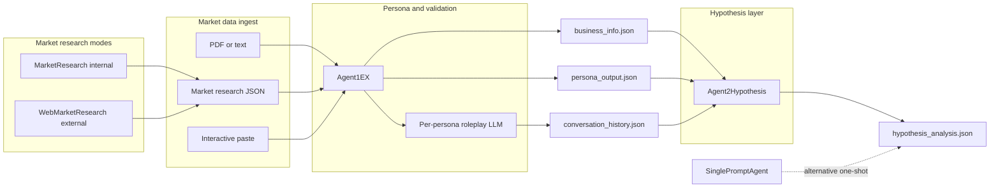

# ResearchLLM — Full Project Summary

## Purpose and theme

This workspace is a **research-oriented LLM toolkit** for **market research**, **customer personas**, **hypothesis generation**, and **improvement / strategy** analysis. It is built around **LangChain** + **OpenAI**, with optional **LangSmith** tracing via `.env` (`LANGCHAIN_TRACING_V2`, `LANGCHAIN_API_KEY`, `LANGCHAIN_PROJECT`). Dependencies are declared in **[pyproject.toml](pyproject.toml)** (`pip install -e ".[dev]"`). There is also a **FastAPI** job API under `src/research_llm/api/`, optional **Tavily** search, a **LangGraph** scaffold in `src/research_llm/graph/`, and a **Next.js** UI in [frontend/](frontend/).

Documentation in [Research_Methodology_Explanation.md](Research_Methodology_Explanation.md) (same folder) formalizes the split between **internal** (training-data-only) and **external** (web-augmented) market research.

---

## Major components (by file)

| Area | File(s) | Role |
|------|---------|------|
| **Internal market research** | [scripts/MarketResearch.py](../scripts/MarketResearch.py) | Single LLM call → structured `MarketResearchReport` (Pydantic). No web fetch. |
| **Web market research** | [scripts/WebMarketResearch.py](../scripts/WebMarketResearch.py) | Multi-step: query generation → `gather_web_sources` → relevance scoring → synthesis into `WebMarketResearchReport` (richer schema including `WebSource`, `key_findings`). CLI menu: run research, load saved JSON, exit. |
| **Improvement (internal)** | [scripts/ImprovementResearch.py](../scripts/ImprovementResearch.py) | Generic “improve this subject” analyst with `ImprovementReport` (stakeholders, enhancements, gaps, roadmap, etc.). |
| **Improvement (web)** | [scripts/WebImprovementResearch.py](../scripts/WebImprovementResearch.py) | Same idea as web market research but framed as improvement analysis from web sources (`WebImprovementAgent`). |
| **Multi-persona pipeline (main)** | [scripts/Agent1EX.py](../scripts/Agent1EX.py) | End-to-end: ingest market data (PDF, text, JSON from research agents, interactive, or sample) → collect **business description + vision** → generate **3 personas** (with retry + parse + fallback) → **interactive roleplay** per persona → writes under `data/outputs/`: `business_info.json`, `persona_output.json`, `conversation_history.json`. |
| **Hypothesis / prototypes** | [scripts/Agent2Hypothesis.py](../scripts/Agent2Hypothesis.py) | Reads outputs from Agent1EX; generates hypotheses from personas + conversations + market context; parses numbered hypotheses and generates **per-hypothesis prototype recommendations**. Can load market research JSON (including web reports). Output includes `data/outputs/hypothesis_analysis.json`. |
| **Single-shot combined analysis** | [scripts/SinglePromptAgent.py](../scripts/SinglePromptAgent.py) | One large prompt produces personas, hypotheses, and prototype ideas in one pass, with explicit **business context** and optional PDF/text input paths (overlaps Agent1+2 conceptually but without multi-turn persona chat). |
| **Earlier / simpler persona scripts** | [scripts/Agent1Persona.py](../scripts/Agent1Persona.py), [scripts/Second.py](../scripts/Second.py) | Older variants: multi-persona without the same business-context wiring as Agent1EX; Second mirrors early single-persona + roleplay from Agent1Persona style. |
| **Utility chat** | [scripts/Chat.py](../scripts/Chat.py) | Minimal ChatGPT loop with history/clear/history commands (not part of the research pipeline). |
| **Tests / samples** | [scripts/test_pdf.py](../scripts/test_pdf.py), [data/samples/](../data/samples/) | Sample inputs and ad-hoc research text. |

---

## Agentic workflows (how pieces connect)

**Pipeline A — Full qualitative + generative stack (intended order)**

1. Produce **market_data** (any source). **Web path:** [scripts/WebMarketResearch.py](../scripts/WebMarketResearch.py) → save JSON under `data/outputs/`. **Internal path:** [scripts/MarketResearch.py](../scripts/MarketResearch.py).
2. Run [scripts/Agent1EX.py](../scripts/Agent1EX.py): personas grounded in market data + **business description/vision** → user interviews **in character** (commands: `exit`, `switch`, `memory`).
3. Run [scripts/Agent2Hypothesis.py](../scripts/Agent2Hypothesis.py): hypotheses + prototype recommendations from structured files.

**Pipeline B — Single-call shortcut**

- [scripts/SinglePromptAgent.py](../scripts/SinglePromptAgent.py) collapses persona + hypothesis + prototypes into **one** LLM response (faster, less interactive validation).

**Parallel “improvement” agents**

- [scripts/ImprovementResearch.py](../scripts/ImprovementResearch.py) and [scripts/WebImprovementResearch.py](../scripts/WebImprovementResearch.py) are **standalone** strategic/improvement analyzers (not wired automatically into Agent1/2 in the snippets reviewed).

---

## Data artifacts (project state)

- **`data/outputs/business_info.json`** — `market_data`, `business_description`, `business_vision`. `market_data` may embed a **stringified JSON** from a web market research run.  
- **`data/outputs/persona_output.json`** — Parsed personas plus `raw_text` and business fields.  
- **`data/outputs/conversation_history.json`** — Per-`persona_N` sessions: persona dict + list of `{user, persona}` turns.  
- **`data/outputs/hypothesis_analysis.json`** — Output from the hypothesis agent when run.

---

## Methodology doc vs code

[Research_Methodology_Explanation.md](Research_Methodology_Explanation.md) states external search uses **DuckDuckGo, Bing, Yahoo**. [scripts/WebMarketResearch.py](../scripts/WebMarketResearch.py) defines search URL patterns including **google**, **bing**, **duckduckgo** in `self.search_engines` — implementation details may have drifted from the markdown; treat the **code** as ground truth for behavior.

---

## Security and hygiene (important)

Multiple Python files **embed OpenAI and LangSmith API keys in source**. This is a **critical exposure risk** if the repo is shared or published. Recommendation: rotate keys, move to environment variables only, and add the repo to `.gitignore` for secrets (not done in current listing).

---

## “Previous chat history” — what we could and could not use

- **Cursor IDE agent transcripts** for *this* user were **not available** to this session (the configured transcripts path did not resolve here), so **prior multi-turn Cursor conversations cannot be summarized from disk**.
- **In-repo “chat history”** refers to **`data/outputs/conversation_history.json`** — scripted **persona roleplay** logs from Agent1EX, not AI assistant chat logs.

---

## Summary sentence

**ResearchLLM** is a collection of LangChain agents for **internal vs web-augmented market research**, a **three-persona interactive interview workflow** that feeds a **hypothesis and prototype recommender**, plus **standalone improvement agents** and utilities—centered on JSON handoffs between stages (under `data/outputs/`) and documented in [Research_Methodology_Explanation.md](Research_Methodology_Explanation.md).
